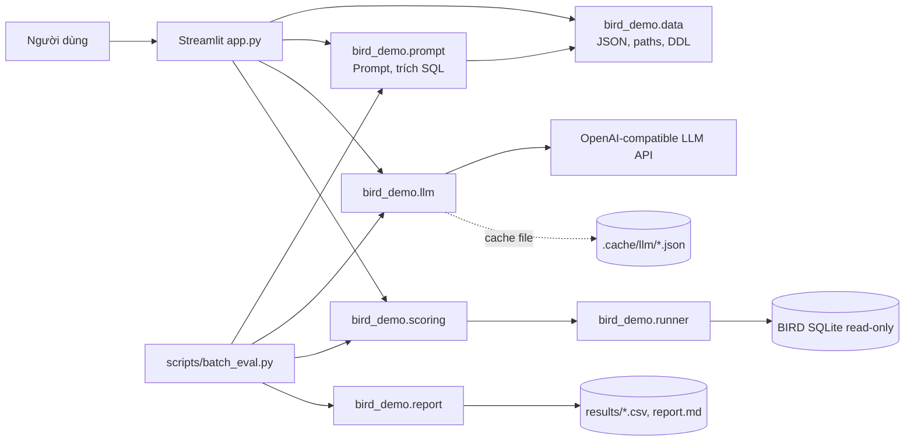
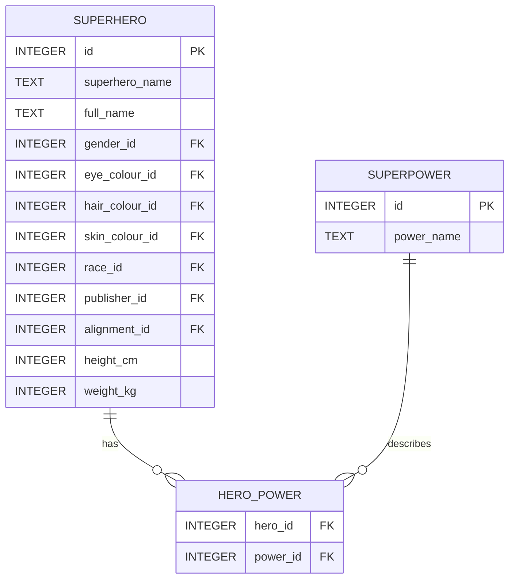
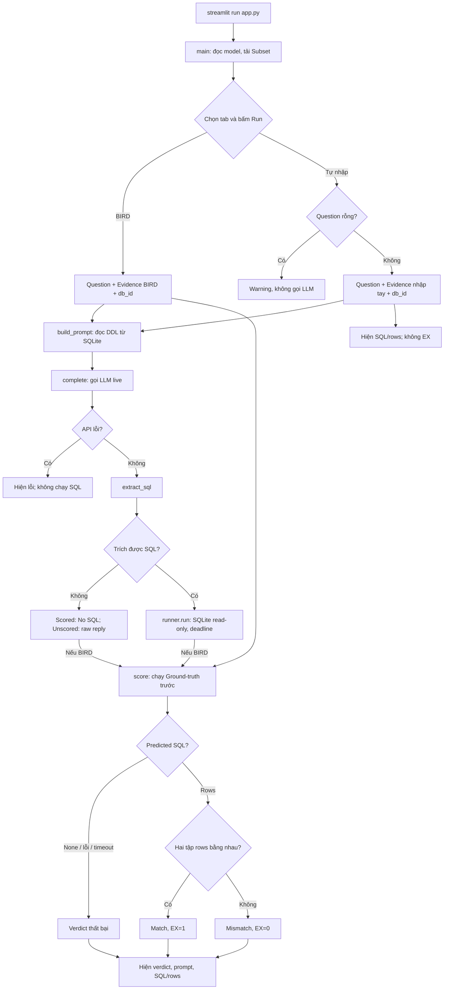
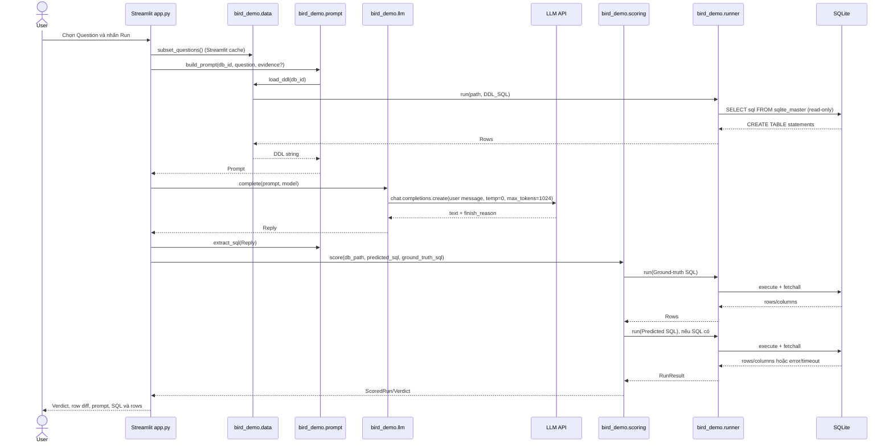
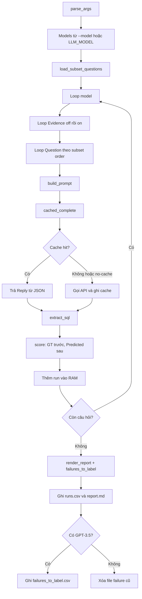

# IS6002 – Phân tích source code và hướng dẫn trace hệ thống

Tài liệu này mô tả source code hiện có trong repo và các file dữ liệu đã kiểm tra. Các kết luận về hành vi được dẫn tới file/hàm/dòng tương ứng. Phân biệt rõ nội dung được xác nhận từ code, dữ liệu, tài liệu dự án và suy luận kỹ thuật. Số dòng áp dụng cho source tại thời điểm phân tích.

## 1. Tổng quan dự án và mục tiêu

IS6002 là demo **Text-to-SQL** dựa trên benchmark BIRD. Người dùng chọn một Question có sẵn hoặc nhập câu hỏi tự do; ứng dụng đưa schema SQLite và Question (cùng Evidence nếu có) cho LLM, trích SQL từ câu trả lời, chạy SQL trên database và hiển thị kết quả. Với Question trong Subset, hệ thống cũng chạy Ground-truth SQL rồi so hai kết quả để gán Verdict. Các thuật ngữ được định nghĩa ở `CONTEXT.md:7-43`; mục tiêu được mô tả ở `README.md:1-8` và triển khai trong `app.py:107-145`.

Đây là ứng dụng Python/Streamlit, không phải MERN và không có backend REST API riêng. UI, điều phối nghiệp vụ, truy cập SQLite và gọi LLM đều diễn ra trong ứng dụng Python. Có thêm batch evaluator phục vụ đánh giá nhiều Question/model.

Cách hiểu nhãn trong tài liệu: **Code** là hành vi được xác nhận trực tiếp từ hàm/câu lệnh; **Data** là kết quả kiểm tra file đang có; **Docs** là mô tả trong README/SPEC; **Suy luận** là đánh giá kỹ thuật, không phải chức năng đã triển khai. Khi Docs và Code khác nhau, phần này mô tả Code.

## 2. Technology Stack

| Thành phần | Công nghệ | Vai trò | File triển khai |
|---|---|---|---|
| Ngôn ngữ/runtime | Python 3.12 (`>=3.12,<3.13`) | Chạy UI, logic, script và tests | `.python-version:1`, `pyproject.toml:1-6` |
| Dependency/environment | `uv`, `pyproject.toml`, `uv.lock` | Chọn Python, cài dependency và chạy lệnh trong môi trường dự án | `README.md:56-65`, `pyproject.toml:7-23` |
| UI | Streamlit `>=1.65` | Form, tab, trạng thái tương tác, bảng và thông báo | `pyproject.toml:7-11`, `app.py:148-179` |
| LLM API | OpenAI Python SDK, endpoint OpenAI-compatible | Gửi prompt tới OpenRouter mặc định hoặc provider tương thích | `bird_demo/llm.py:43-58`, `.env.example` |
| Cấu hình | `.env` + python-dotenv | Nạp URL, API key và model; `.env` bị Git ignore | `bird_demo/llm.py:15-18,30-40`, `.gitignore:1-4` |
| Database | SQLite, thư viện chuẩn `sqlite3` | Chứa schema và dữ liệu BIRD; chạy truy vấn chỉ đọc | `bird_demo/runner.py:1-4,35-59` |
| Lưu file | JSON, CSV, Markdown | Câu hỏi/Subsets, cache LLM và báo cáo batch | `bird_demo/data.py:23-66`, `bird_demo/llm.py:60-71`, `scripts/batch_eval.py:35-39,83-96` |
| Kiểm thử | pytest | Test logic offline bằng SQLite tạm và stub LLM | `pyproject.toml:13-24`, `tests/` |

`uv` quản lý môi trường và dependency; `pyproject.toml` khai báo dependency/Python range; `uv.lock` khóa phiên bản; `.env` chứa cấu hình runtime, không phải dữ liệu benchmark. Source gọi API đồng bộ qua `client().chat.completions.create(...)`. Không có ORM, connection pool, async processing hoặc concurrency. `client()` được memoize trong process bằng `functools.cache`; mỗi lần SQL được chạy thì mở rồi đóng một SQLite connection riêng (`bird_demo/llm.py:42-58`, `bird_demo/runner.py:35-59`).

## 3. Kiến trúc hệ thống

`app.py` là entry point Streamlit; `bird_demo/` là các module UI và batch dùng chung; `scripts/` chứa entry point tạo Subset/đánh giá; SQLite/JSON/CSV là file trên đĩa. Đây không phải kiến trúc nhiều backend service.



**Backend API độc lập?** Không có Flask/FastAPI/Express hay endpoint HTTP do project định nghĩa. Streamlit gọi trực tiếp hàm Python. API ngoài trong luồng chính là API LLM.

## 4. Cấu trúc source code

| File/module | Chức năng | Hàm/class chính | Được gọi bởi | Phụ thuộc chính |
|---|---|---|---|---|
| `app.py` | Entry point UI; phân nhánh Scored/Unscored run | `main`, `scored_run`, `unscored_run`, `ask_llm`, `show_*` (`app.py:37-179`) | `streamlit run app.py` | `bird_demo.*`, Streamlit, OpenAIError |
| `bird_demo/data.py` | Đường dẫn; đọc JSON/Subsets; xác định SQLite; lấy DDL | `require`, `load_subset_questions`, `db_path`, `load_ddl` (`data.py:23-74`) | UI, prompt, scripts | JSON, pathlib, runner |
| `bird_demo/prompt.py` | Tạo prompt, trích SQL khỏi response | `build_prompt`, `extract_sql` (`prompt.py:31-49`) | UI và batch | `data.load_ddl`, `llm.Reply` |
| `bird_demo/llm.py` | Cấu hình, gọi API, cache batch | `client`, `complete`, `cached_complete` (`llm.py:30-71`) | UI và batch | OpenAI SDK, dotenv, filesystem |
| `bird_demo/runner.py` | Thực thi statement read-only, deadline | `run`; `Rows`, `SqlError`, `Timeout` (`runner.py:16-59`) | data, scoring, subset script | sqlite3, pathlib, time |
| `bird_demo/scoring.py` | Chạy hai SQL và tính Verdict | `score`, `ScoredRun`, `Verdict` (`scoring.py:10-61`) | UI, batch | runner |
| `bird_demo/report.py` | EX, bảng report, chọn failure cần gán nhãn | `ex`, `render_report`, `failures_to_label` (`report.py:49-171`) | batch | `Verdict`, run rows |
| `scripts/make_subset.py` | Lọc, lấy mẫu và kiểm tra Subset | `filter_pool`, `pick_subset`, `check_ground_truth`, `main` (`make_subset.py:27-98`) | Chạy script | data, runner |
| `scripts/batch_eval.py` | Điều phối batch, ghi kết quả | `main`, `write_csv` (`batch_eval.py:35-100`) | Chạy script | modules bird_demo, SDK |
| `subset.json` | 50 ID cố định; không chứa câu hỏi/SQL | JSON list | `data.load_subset()` | `dev.json` để lấy nội dung |
| `tests/` | Kiểm thử logic với DB tạm, LLM stub | `test_runner`, `test_scoring`, `test_prompt`, `test_llm` | pytest | Không cần LLM live theo SPEC |

### Các hàm chính và side effects

- `data.load_subset_questions()` đọc `dev.json` và `subset.json`, ghép theo `question_id` và trả Question đầy đủ theo thứ tự Subset; chỉ đọc file (`bird_demo/data.py:48-51`). `require()` báo thiếu file với hướng dẫn tới README (`data.py:23-32`).
- `data.load_ddl(db_id)` dùng runner để truy vấn `sqlite_master`, lấy DDL và ghép bằng hai newline (`data.py:20,68-74`). Đây là schema đưa cho LLM.
- `prompt.build_prompt()` chọn template theo Evidence (`prompt.py:31-36`).
- `llm.complete()` gửi một chat completion với một user message, `temperature=0`, `max_tokens=1024`; trả `Reply(text, finish_reason)` (`llm.py:48-58`). Side effect: gọi mạng; lỗi SDK truyền lên caller.
- `llm.cached_complete()` dùng SHA-256 của `model + prompt` làm khóa cache; đọc hit hoặc gọi API rồi ghi file tạm và rename (`llm.py:60-71`).
- `prompt.extract_sql()` từ chối response bị cắt, lấy code fence cuối nếu có, cắt một dấu `;` cuối và chỉ nhận SELECT/WITH sau comment (`prompt.py:38-49`). Đây là kiểm tra cấu trúc, không phải cơ chế bảo mật.
- `runner.run()` mở SQLite URI với `mode=ro`, đặt deadline bằng progress handler, execute/fetch toàn bộ hàng, đóng connection trong `finally`, và trả Rows/SqlError/Timeout (`runner.py:35-59`).
- `scoring.score()` chạy Ground-truth trước; nếu lỗi thì ném `GroundTruthError`; tiếp theo xử lý No SQL/SQL error/Timeout hoặc so set kết quả (`scoring.py:32-61`).
- `app.ask_llm()` hiển thị spinner, bắt `OpenAIError` và không chạy SQL nếu API thất bại (`app.py:97-105`). `scored_run()` và `unscored_run()` điều phối các bước tiếp theo (`app.py:107-145`).
- `batch_eval.main()` chạy tuần tự model → Evidence off/on → Question; lỗi API dừng batch. Khi toàn bộ hoàn thành, batch ghi CSV/Markdown và tạo hoặc xóa failure-label file (`batch_eval.py:42-96`).

## 5. Nguồn dữ liệu và cách lưu trữ

Project không có RDBMS lưu state ứng dụng. SQLite BIRD chỉ là database để chạy SQL; danh sách câu hỏi, cache, kết quả và cấu hình lần lượt nằm trong JSON, JSON cache, CSV/Markdown và `.env`.

| Nguồn | Nguồn gốc/định dạng/schema | Ai đọc/ghi | Mục đích và có sửa dữ liệu gốc? |
|---|---|---|---|
| `data/dev_20240627/dev.json` | BIRD dev JSON; record có `question_id`, `db_id`, `question`, `evidence`, `SQL`, `difficulty` theo SPEC mục 4 | `data.load_dev()`/`load_subset_questions()` và subset script đọc | Question, Evidence, Ground-truth SQL; runtime không ghi file này. |
| `data/dev_20240627/dev_databases/*.sqlite` | SQLite schema và dữ liệu benchmark | runner đọc read-only; `load_ddl()` đọc schema | Database chạy Predicted/GT SQL; source không ghi dữ liệu gốc. |
| `dev_tables.json`, `dev_tied_append.json`, `dev.sql`, CSV descriptions | File benchmark JSON/SQL/CSV | Runtime chỉ subset creator đọc tied file; descriptions và `dev_tables.json` không dùng trong luồng app | `dev_tied_append` lọc câu hỏi có SQL thay thế. SPEC mục 4 xác nhận CSV descriptions không dùng. |
| `data/dev_20251106/dev.json` | JSON bản BIRD sửa đổi | `load_revised()`/`make_subset.py` | Chỉ lọc SQL đã thay đổi khi tái tạo Subset; app runtime không đọc. File chưa có trong workspace lúc kiểm tra. |
| `subset.json` | JSON list `question_id`, `db_id`, `difficulty`; có 50 entries | UI/batch đọc; `make_subset.py` ghi đè nếu chạy | Danh sách và thứ tự cố định dùng chung. App không cần tạo lại. |
| `.cache/llm/<sha256>.json` | Mỗi file lưu `model`, `prompt`, `text`, `finish_reason` | `cached_complete()` đọc/ghi; batch gọi wrapper này | Cache response batch theo model + prompt; Streamlit gọi `complete()` trực tiếp. Thư mục hiện không có JSON cache. |
| `results/runs.csv` | CSV một dòng/run; cột khai báo ở `scripts/batch_eval.py:25` | Batch ghi đè khi toàn bộ run xong | Kết quả/SQL, không phải bảng SQLite; file hiện có trong repo. |
| `results/report.md` | Markdown | Batch ghi; `report.py` tạo nội dung | Tổng hợp EX/Verdict; file hiện có. |
| `results/failures_to_label.csv` | CSV failure cần người gán nguyên nhân; cột ở `report.py:40-43` | Batch ghi nếu chạy GPT-3.5; nếu không sẽ xóa file cũ | Phân tích lỗi thủ công; file hiện có. |
| `.env` | `KEY=value`: `LLM_BASE_URL`, `LLM_API_KEY`, `LLM_MODEL` | python-dotenv nạp lúc import `llm.py` | Cấu hình kết nối, bị Git ignore. Không đọc nội dung bí mật; file hiện chưa có. |

Đường dẫn data được cố định theo root trong `bird_demo/data.py:12-20`. `data/`, `.cache/` bị ignore trong `.gitignore`; JSON/CSV không phải bảng RDBMS. Nguồn tải và cấu trúc dự kiến được ghi trong `README.md:10-49`; quy tắc Subset ở `SPEC.md` mục 4.

## 6. Thiết kế CSDL và ERD

### Cách code lấy schema

`bird_demo/data.py:20` định nghĩa truy vấn `sqlite_master` lấy câu tạo bảng, sắp theo `rowid`; `load_ddl()` chạy qua runner và ghép DDL bằng hai newline (`data.py:68-74`). Prompt dùng DDL này; không dùng `dev_tables.json` hoặc CSV descriptions để bổ sung schema.

Đã kiểm tra database thật `data/dev_20240627/dev_databases/superhero/superhero.sqlite` ở chế độ read-only qua `sqlite_master`, `PRAGMA table_info`, `PRAGMA foreign_key_list`, `PRAGMA index_list`. Các bảng trong DB: `alignment`, `attribute`, `colour`, `gender`, `publisher`, `race`, `superhero`, `hero_attribute`, `superpower`, `hero_power`. Với Question #720:

- `superhero`: `id INTEGER PRIMARY KEY`, `superhero_name TEXT`, `full_name TEXT`, `gender_id`, `eye_colour_id`, `hair_colour_id`, `skin_colour_id`, `race_id`, `publisher_id`, `alignment_id`, `height_cm`, `weight_kg`; các cột ngoài `id` trong DDL có thể NULL.
- `hero_power`: `hero_id INTEGER`, `power_id INTEGER`, cho phép NULL; FK tới `superhero(id)` và `superpower(id)`.
- `superpower`: `id INTEGER PRIMARY KEY`, `power_name TEXT`.

`hero_power` là bảng nối; hai FK cho thấy quan hệ nhiều-nhiều giữa superhero và superpower. Các bảng lookup còn lại nối qua FK với `superhero`; `hero_attribute` nối `superhero` và `attribute`. Các bảng tham chiếu có integer primary key. PRAGMA cho `superhero`, `hero_power`, `superpower` không liệt kê index riêng phục vụ cột join; integer primary key vẫn là rowid alias. Cardinality 1–N/N–N là diễn giải từ FK/bảng nối, không phải một khai báo cardinality trong SQLite.

Database `toxicology.sqlite` cũng đã được kiểm tra bằng các PRAGMA tương tự. Nó có bốn bảng: `molecule(molecule_id TEXT PK, label TEXT)`, `atom(atom_id TEXT PK, molecule_id TEXT, element TEXT)`, `bond(bond_id TEXT PK, molecule_id TEXT, bond_type TEXT)`, `connected(atom_id TEXT PK-part, atom_id2 TEXT PK-part, bond_id TEXT)`. FK: `atom.molecule_id` và `bond.molecule_id` tới `molecule.molecule_id`; `connected.atom_id`/`atom_id2` tới `atom.atom_id`, `connected.bond_id` tới `bond.bond_id`. Do Subset có Question thuộc cả hai DB, đây là phạm vi schema thứ hai. ERD bên dưới tập trung vào superhero vì phần trace cụ thể là Question #720; không đại diện cho toxicology.

ERD giới hạn ở các bảng tham gia câu hỏi mẫu, dựa trên schema thật:



## 7. Luồng hoạt động tổng thể – Flowchart

Khi khởi chạy, `main()` đọc model cấu hình và tải Question Subset (hàm `subset_questions()` được `st.cache_data` cache) trước khi render UI (`app.py:37-40,148-179`). Schema chỉ được truy vấn sau khi nhấn Run, vì `build_prompt()` mới gọi `load_ddl()`.



Thứ tự thực tế trong `score()` là Ground-truth SQL trước, Predicted SQL sau (`bird_demo/scoring.py:32-45`). Nếu không trích được SQL, Ground-truth vẫn chạy rồi mới trả No SQL. Unscored run không gọi `score()` và không có SQL tham chiếu (`app.py:132-145`).

## 8. Sequence Diagram



Với Unscored run, UI gọi `runner.run()` trực tiếp sau khi có SQL; không gọi scoring/SQL tham chiếu (`app.py:132-145`). UI không ghi response vào `.cache/llm`; cache file chỉ được batch dùng.

## 9. Text-to-SQL Pipeline

Luồng chính: **Question → Schema/Evidence → Prompt → LLM → Predicted SQL → SQLite → Verdict/EX**.

### Schema, Evidence, Prompt

`load_ddl()` đọc schema từ database thật. DDL được đưa đầu prompt theo thứ tự trong `sqlite_master` (`bird_demo/data.py:20,68-74`). Code không gửi sample rows, CSV descriptions hoặc `dev_tables.json`.

Template có Evidence ở `bird_demo/prompt.py:15-21`; không Evidence ở `prompt.py:24-29`. Evidence là câu ánh xạ từ khái niệm câu hỏi sang điều kiện/giá trị DB. Tắt Evidence sẽ bỏ dòng `External Knowledge`, đồng thời đổi phần hướng dẫn sang “Using valid SQLite”; DDL và Question không đổi. Typed run lấy Evidence từ người dùng và đổi chuỗi rỗng thành `None` (`app.py:164-166,176-178`).

### Gọi LLM và xử lý response

`complete()` tạo chat completion qua OpenAI SDK: model từ `LLM_MODEL`, một message `role=user` chứa prompt, `temperature=0`, `max_tokens=1024`; không streaming/tools/system message (`bird_demo/llm.py:48-58`). Response lấy `choices[0].message.content` và `finish_reason` vào dataclass `Reply`.

`extract_sql()` lấy code fence cuối cùng nếu có, nếu không dùng toàn text. Response `finish_reason == "length"` trả None. SQL được trim, bỏ dấu `;` cuối, phải bắt đầu SELECT/WITH sau comment SQL (`bird_demo/prompt.py:38-49`). Đây là kiểm tra cú pháp đầu vào đơn giản, không đảm bảo SQL an toàn hay đúng nghiệp vụ.

### Thực thi SQL và safeguards

Runner mở file qua URI `mode=ro`, `cursor.execute()` (một statement), đặt deadline 30 giây qua progress handler mỗi 10.000 VM steps, phân biệt Timeout với lỗi SQLite và đóng connection (`bird_demo/runner.py:12-14,35-59`). Không có parser/allowlist SQL hay sandbox tiến trình. Read-only ngăn sửa benchmark; query vẫn có thể đọc mọi bảng trong DB đã chọn và tốn CPU/bộ nhớ. `fetchall()` lấy mọi hàng; giới hạn 1.000 ở UI chỉ là giới hạn hiển thị, không phải giới hạn query (`app.py:20,46-63`).

### Verdict và EX

`score()` chạy Ground-truth trước; nếu reference lỗi/timeout, ném `GroundTruthError`. Nếu không có Predicted SQL thì `No SQL in reply`; lỗi/timeout cho Verdict tương ứng; nếu có rows thì so `set(tuple_row)` (`bird_demo/scoring.py:32-61`).

- Bỏ qua thứ tự hàng.
- Bỏ qua hàng trùng do dùng set.
- Thứ tự cột và số cột còn quan trọng vì mỗi row là tuple.
- Kiểu giá trị còn quan trọng: `1` khác `'1'`.
- Tên cột không tham gia so sánh.
- Không dung sai số thực; NULL được so như `None` trong tuple.

EX của một nhóm là số Match chia cho toàn bộ run, tính bằng phần trăm (`bird_demo/report.py:53-59`). No SQL/SQL error/Timeout vẫn ở mẫu số. Với 50 câu hỏi, một Match tương ứng 2 điểm phần trăm.

Runtime dùng trường `SQL` duy nhất làm Ground-truth. `dev_tied_append.json` chỉ dùng lọc các Question có SQL thay thế khi tạo Subset; code không chạy tất cả alternate SQL để chấm (`scripts/make_subset.py:31-41`, `bird_demo/data.py:59-62`).

### Cache

`cached_complete()` đặt tên cache bằng SHA-256 của `model + prompt`; cache hit trả Reply mà không gọi API; `refresh=True` bỏ qua cache read nhưng vẫn ghi (`bird_demo/llm.py:60-71`). Cache key không gồm base URL/provider hoặc generation parameters khác. App không dùng response cache file; `client()` chỉ memoize client trong process.

## 10. Thuật toán Execution Accuracy

```text
G = run(Ground-truth SQL)
Nếu G lỗi/timeout: GroundTruthError (không phải Verdict cho model)
Nếu không có Predicted SQL: Verdict No SQL, EX(q)=0
P = run(Predicted SQL)
Nếu P lỗi/timeout: Verdict tương ứng, EX(q)=0
Nếu set(P.rows) == set(G.rows): Match, EX(q)=1
Ngược lại: Mismatch, EX(q)=0
EX(dataset) = 100 * tổng EX(q) / số Question được chạy
```

Đây là so **kết quả thực thi**, không so chuỗi SQL; câu query khác nhau vẫn Match nếu tập rows bằng nhau. Phép so set nằm ở `bird_demo/scoring.py:47-61`; phần trăm ở `bird_demo/report.py:53-59`.

## 11. Batch Evaluation Pipeline

`scripts/batch_eval.py` lấy Question từ Subset giống app; models lấy từ các `--model` hoặc `LLM_MODEL`; Evidence luôn chạy off rồi on; các vòng lặp tuần tự theo model → setting → Question (`batch_eval.py:42-53`). Hai model × 50 Question × 2 settings = 200 runs.



`report.py` lọc theo model/Evidence, tính Match rate, nhóm difficulty và đếm Verdict (`bird_demo/report.py:49-154`). `runs.csv` lưu từng run và SQL/error; `report.md` tổng kết; `failures_to_label.csv` chỉ gồm mismatch/SQL error/timeout ở GPT-3.5 Evidence ON (`scripts/batch_eval.py:77-96`, `bird_demo/report.py:158-171`). Hai cột failure cause/note được để trống; script không đọc `labels.csv`.

Nếu API call lỗi sau retries, batch dừng và chưa ghi báo cáo dở; các reply đã cache có thể dùng lại. SQL error/timeout là Verdict và không dừng batch; Ground-truth lỗi làm dừng do dữ liệu/setup bất thường (`batch_eval.py:54-63`, `scoring.py:35-41`).

**So với Streamlit:** app chạy một Question mỗi lần bấm nút và gọi `complete()` live không cache; batch chạy toàn Subset với nhiều model, cả Evidence ON/OFF, dùng cache và ghi báo cáo. Hai đường dùng chung prompt, runner, scoring (`app.py:107-145`, `batch_eval.py:42-96`).

## 12. Trace Question thực tế

Ví dụ là **Question #720**, trong `subset.json` với `db_id=superhero`, `difficulty=simple`. `data/dev_20240627/dev.json` có nội dung:

> **Question:** Please list the full names of all the superheroes with over 15 super powers.  
> **Evidence:** 15 super powers refers to COUNT(full_name) > 15

Ground-truth SQL:

```sql
SELECT DISTINCT T1.full_name
FROM superhero AS T1
INNER JOIN hero_power AS T2 ON T1.id = T2.hero_id
GROUP BY T1.full_name
HAVING COUNT(T2.power_id) > 15
```

Database là `data/dev_20240627/dev_databases/superhero/superhero.sqlite`. Schema liên quan gồm `superhero(id, full_name, ...)` và `hero_power(hero_id, power_id)`; FK nối `hero_power.hero_id` với `superhero.id`, và `power_id` với `superpower.id`. `build_prompt()` thực tế sẽ đưa DDL của tất cả bảng vào prompt, thêm Evidence/Question theo template.

Không gọi LLM trong lần phân tích. `.cache/llm/` hiện không có JSON response. Tuy nhiên, `results/runs.csv` lưu Predicted SQL từ batch trước. Với `openai/gpt-4.1`, Evidence ON, artifact đó ghi:

```sql
SELECT s.full_name
FROM superhero s
JOIN hero_power hp ON s.id = hp.hero_id
GROUP BY s.id, s.full_name
HAVING COUNT(hp.power_id) > 15
```

Đã chạy lại hai SQL này trên SQLite local ở read-only để kiểm chứng: Predicted có 65 rows, Ground-truth có 71; không có hàng chỉ ở Predicted, có 6 tên chỉ ở Ground-truth: Bartholomew Allen II, Edward Charles Allan Brock, Erik Stephan Josten, MacDonald Gargan, Richard John Grayson, Wallace Rudolph West. Hai set khác nhau nên verdict **Mismatch**, EX=0.

Giải thích từ câu SQL và kết quả: Predicted nhóm theo `s.id, s.full_name`, nên đếm power riêng từng superhero ID; Ground-truth nhóm theo `T1.full_name`, nên có thể gộp các bản ghi superhero trùng full name. Khác biệt này có thể giải thích 6 hàng thiếu; đây là suy luận từ SQL/dữ liệu, không phải lời giải thích của LLM.

Predicted SQL/Verdict lấy từ artifact hiện có (`results/runs.csv`, các record #720; chi tiết Question #720 cũng có trong `results/failures_to_label.csv`). Đây là output batch đã lưu, không đảm bảo LLM sẽ trả đúng câu đó ở lần gọi mới. Report hiện có ghi GPT-4.1 40% Evidence off, 68% Evidence on; GPT-3.5 28%/66% (`results/report.md:13-14,22-23`). Đây là số trong artifact, không phải batch vừa chạy.

## 13. Xử lý lỗi, caching và bảo mật

| Trường hợp | Hành vi hiện tại | Dẫn chứng |
|---|---|---|
| Thiếu data | `SystemExit` có đường dẫn và chỉ README; app hiển thị `st.error` | `data.py:23-32`, `app.py:180-183` |
| Thiếu biến `.env` | `env()` dừng với hướng dẫn copy `.env.example` | `llm.py:30-46` |
| API lỗi | App báo lỗi và không chạy SQL; batch dừng | `app.py:97-105`, `batch_eval.py:54-60` |
| Không trích SQL | `None`; Scored: No SQL; Unscored: hiển thị raw reply | `prompt.py:38-49`, `scoring.py:35-39`, `app.py:65-75` |
| SQL lỗi | Trả `SqlError(message)` và UI hiển thị | `runner.py:54-57`, `app.py:65-78` |
| Query quá lâu | Progress handler ngắt; trả Timeout | `runner.py:12-14,41-57` |
| Ground-truth lỗi | Ném GroundTruthError, không quy lỗi cho LLM | `scoring.py:35-37` |
| Question typed rỗng | Warning; không gọi LLM | `app.py:173-178` |

Các bảo vệ có trong code: SQLite `mode=ro`, dùng `execute` cho một statement, deadline cho query, API key không hard-code và `.env` bị ignore (`runner.py:37-39`, `.gitignore:1-4`).

Giới hạn/rủi ro có thể xác nhận:

- Kiểm tra đầu SQL là SELECT/WITH không phải sandbox. Chặn ghi chủ yếu nhờ SQLite read-only; không có SQL allowlist hoặc giới hạn bảng/cột.
- Read-only không hạn chế đọc dữ liệu. Query vẫn có thể tốn CPU/bộ nhớ; `fetchall()` lấy mọi row trước khi UI chỉ hiển thị tối đa 1.000.
- Deadline áp dụng mỗi query, không gồm thời gian chờ LLM. Code cấu hình `max_retries=3` nhưng không truyền timeout HTTP riêng vào `OpenAI(...)` (`llm.py:43-46`).
- Cache lưu nguyên prompt và response (không lưu API key), nên chứa nội dung Question được gửi provider. Key chỉ có model + prompt; đổi provider hoặc generation params mà giữ hai chuỗi đó có thể tái sử dụng cache cũ.
- UI và batch đồng bộ, không có queue/background processing/concurrency.

## 14. Đánh giá kiến trúc và đề xuất cải thiện

### Điểm tốt

- UI và batch dùng chung prompt, LLM adapter, runner và scoring, giảm nguy cơ hai đường cho verdict khác nhau (`app.py:107-145`, `batch_eval.py:17-21`).
- Các module prompt, llm, runner, scoring, report có trách nhiệm khá tập trung; entry scripts điều phối.
- Runner trả kiểu kết quả tường minh, đóng connection trong `finally`.
- Subset cố định và seed giúp lặp lại danh sách benchmark; script kiểm tra Ground-truth trước khi ghi (`make_subset.py:56-80`).
- Tests dùng DB tạm/LLM stub, cover read-only, timeout, extraction, equality và cache (`tests/test_runner.py`, `tests/test_prompt.py`, `tests/test_scoring.py`, `tests/test_llm.py`).
- OpenAI-compatible endpoint giúp đổi provider qua config (`llm.py:43-58`).

### Coupling và khả năng mở rộng

Cohesion trong các module tương đối tốt. UI/batch phụ thuộc trực tiếp dataclass và hàm Python, phù hợp demo. Đổi sang LLM tương thích OpenAI dễ qua config; đổi database khó hơn vì đường dẫn, schema introspection và execution đều gắn SQLite. Batch tuần tự dễ theo dõi nhưng tốn thời gian; `fetchall()` có thể tiêu thụ nhiều memory. Cache giảm gọi API nhưng chưa phiên bản hóa endpoint/tham số. Đường dẫn data cố định theo phiên bản benchmark và hai DB, phù hợp mục tiêu demo hơn là triển khai đa môi trường.

### Đề xuất trước khi dùng production (chưa triển khai)

1. Bổ sung SQLite authorizer hoặc chạy snapshot trong sandbox cách ly; giới hạn CPU, thời gian, RAM và số hàng trả về.
2. Cân nhắc schema linking để chỉ đưa DDL liên quan vào prompt.
3. Cấu hình timeout mạng LLM và phân loại lỗi mạng, quota, rate-limit, cấu hình.
4. Phiên bản hóa cache theo provider/base URL, generation params và prompt/schema revision.
5. Với batch lớn, thêm checkpoint từng run; hiện tại kết quả chỉ ghi sau khi toàn bộ batch xong.
6. Thêm test UI và test trên đúng BIRD data; tests hiện có dùng fixture nhỏ theo SPEC.
7. Khi nhiều người dùng, đánh giá rate limit, quyền đọc data/cache/results, bảo vệ `.env` và chính sách lưu prompt gửi provider.

## 15. File/function nên đọc theo thứ tự

1. `README.md:1-76` – mục tiêu, dữ liệu, lệnh chạy, cấu hình LLM.
2. `CONTEXT.md:7-43` – thuật ngữ Question/Evidence/SQL/EX/Verdict.
3. `pyproject.toml:1-24`, `.python-version:1`, `.env.example` – runtime, dependency, config.
4. `app.py:148-179` – entry point và UI; sau đó `app.py:107-145` – Scored/Unscored flow.
5. `bird_demo/data.py:12-74` – đường dẫn, nạp Question, lấy DDL.
6. `bird_demo/prompt.py:15-49` – prompt và extraction.
7. `bird_demo/llm.py:30-71` – config, API request và cache; không cần mở `.env` để hiểu cơ chế.
8. `bird_demo/runner.py:12-59` – read-only, deadline, query result.
9. `bird_demo/scoring.py:10-61` – Verdict/EX của một Question.
10. `scripts/batch_eval.py:28-100` và `bird_demo/report.py:49-171` – batch và report.
11. `scripts/make_subset.py:27-98` – cách tạo Subset 50 câu.
12. `tests/test_prompt.py`, `tests/test_runner.py`, `tests/test_scoring.py`, `tests/test_llm.py` – test executable cho quy tắc lõi.
13. Mở `subset.json`, record trong `data/dev_20240627/dev.json`, rồi `results/runs.csv` để trace Question cụ thể như #720.

### Tự trace trong VS Code

1. Mở `app.py`; đặt breakpoint trong `main()` rồi `scored_run()`.
2. Chọn Question BIRD và Run; quan sát `q`, `use_evidence`, `model` trước `build_prompt()`.
3. Step Into `build_prompt()` → `load_ddl()` → `runner.run()` để xem schema thật.
4. Nếu chỉ đọc code, không cần chạy API. Nếu muốn đặt breakpoint `complete()`, lưu ý bước đó gửi request LLM và có thể tính phí.
5. Step qua `extract_sql()` để thấy response thành SQL hoặc `None`.
6. Step Into `score()` → `run()` hai lần để xem Ground-truth trước, Predicted sau, rồi Verdict/row diffs.
7. Với batch, đặt breakpoint tại các vòng lặp `scripts/batch_eval.py:49-53`, theo dõi một record và report cuối.

## Phạm vi kiểm tra lần này

Đã đọc source, Question #720, Subset và batch outputs; kiểm tra schema/foreign keys/indexes SQLite bằng thao tác read-only; chạy lại hai SQL của #720 trên DB local read-only để xác nhận row counts/diffs. Không gọi LLM API, không đọc nội dung `.env`, không sửa dữ liệu benchmark và không chạy batch. Tại thời điểm kiểm tra, `data/dev_20251106/dev.json` và `.env` chưa có; `.cache/llm/` không có JSON response. Vì vậy prompt được mô tả từ code, còn Predicted SQL ví dụ được lấy từ batch result đã lưu.
